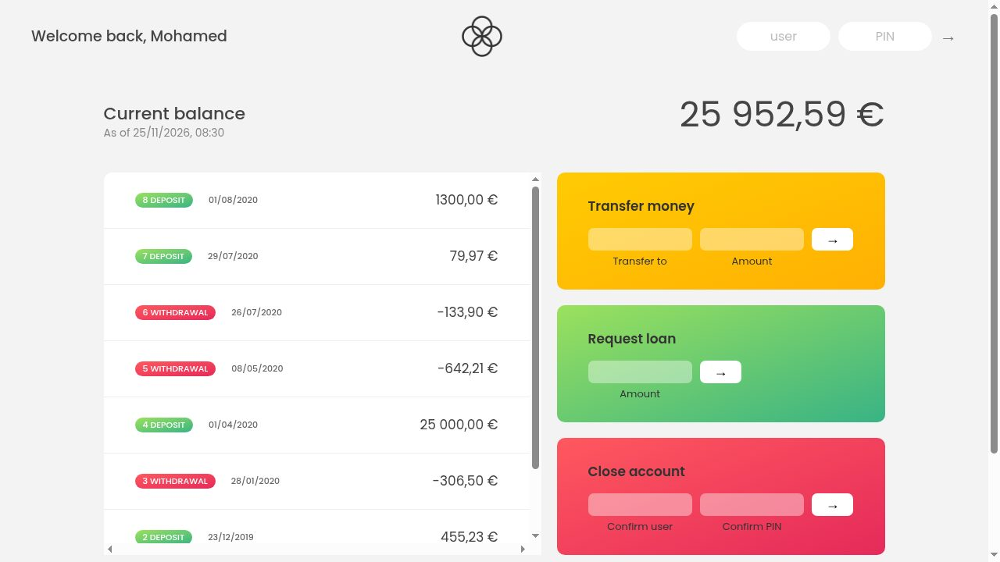

# Bankist App

A banking app simulation: log in, see your balance and movements, transfer money, ask for a loan and close the account.

**Try it:** https://mhmd7710d.github.io/Bankist-Project/

## Demo accounts
- Username `mf`, PIN `1111`
- Username `af`, PIN `2222`
- Username `of`, PIN `3333`
- Username `nf`, PIN `4444`

## What you can try
- Log in with one of the accounts above.
- Transfer an amount to another username (`af`, `of`, `nf`) and watch the balance and the movements update.
- Ask for a loan, then wait a moment and see the money arrive.
- Sort the movements, or close the account with the same PIN.

## Built with
Plain HTML, CSS and JavaScript. No libraries and no build step.

## What I practised
Arrays and array methods (`map`, `filter`, `reduce`, `sort`), dates and timers, the Intl API for localised dates and currencies, DOM updates, and login and logout state with an automatic logout timer.

## Run it locally
Download the repository and open `index.html` in a browser.

## Credits
Original project from Jonas Schmedtmann's Complete JavaScript Course, all copyright to Jonas Schmedtmann. Personalized by Mohamed Fathy.

## Contact
- LinkedIn: https://www.linkedin.com/in/muhammad-fathi-b7a693424/
- X (Twitter): https://x.com/mouahid7710
- Facebook: https://www.facebook.com/share/1CQhxpCeYL/
- Instagram: https://www.instagram.com/mhmd7710d/
- Email: muhammutfathi@gmail.com
- WhatsApp: https://wa.me/201040428475?text=Hi+Mohamed%2C+I+found+your+project+on+GitHub.
